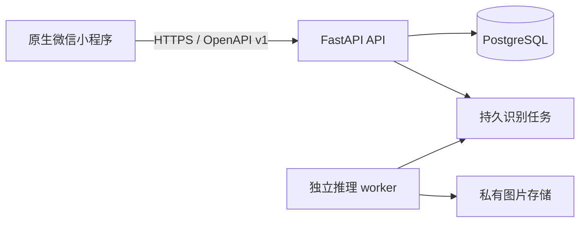

# 数得快后端服务架构

## 1. 定位与边界

`backend/` 是 FastAPI 模块化业务单体和独立推理 worker 的治理根目录。API、worker 和 PostgreSQL 是不同进程；业务 API 不加载模型，模型进程不对公网开放。小程序只通过版本化 OpenAPI 与 HTTPS 调用 API。

当前底座只提供配置、数据库就绪探针、健康端点、共享契约和工程门禁，不实现身份、门店、订单、图片、识别任务或收费业务。



## 2. 目录与职责

```text
backend/
├── src/
│   ├── shudekuai_api/
│   │   ├── app.py                  # 组合根与生命周期
│   │   ├── platform/               # 配置、HTTP、数据库、可观测性
│   │   └── modules/<module>/       # 真实业务 vertical slice
│   └── shudekuai_contracts/        # API 与 worker 共享的纯契约
├── migrations/                     # Alembic，只增不改
├── scripts/                        # Profile、架构、OpenAPI 与安全门禁
└── tests/                          # 单元、契约、HTTP 集成与数据库集成
```

业务模块出现时采用：

```text
transport/http -> application -> domain
infrastructure ---------> application ports
```

Domain 不依赖 FastAPI、Pydantic transport DTO、SQLAlchemy、配置、日志或外部 SDK。Handler 不直接写 SQL、决定业务状态机或解析未验证身份。

## 3. 数据与事务

生产和集成测试只使用 PostgreSQL。写入用例通过显式事务保存业务状态、审计和幂等结果；事务内不执行模型推理、远程 HTTP、图片处理或长时间等待。

迁移只追加，不修改已发布迁移。破坏性 Schema 使用 expand → backfill → cutover → contract。应用启动不得自动执行生产迁移。

## 4. HTTP 与契约

`../contracts/openapi.json` 是唯一 HTTP 传输契约。端点变更必须同步生成契约、摘要、契约测试和前端客户端。业务代码不得复制生成 DTO。

所有错误使用稳定的 `code`、安全的 `message`、`requestId` 和 `retryable`；不得返回堆栈、SQL、凭据、内部地址或下游原始错误。

## 5. 配置与安全

配置只来自环境变量，启动时 fail-closed。数据库 URL 等 Secret 使用受保护类型，不进入仓库、日志、错误、OpenAPI 或镜像层。服务端重新验证门店、身份、版本、金额和完成条件，不信任客户端结论。

## 6. 验证

`make verify` 聚合锁文件同步、格式、Lint、严格类型、Profile、架构、测试覆盖率、OpenAPI 零漂移、依赖漏洞、许可证、Secret 与 wheel 打包检查。真实 PostgreSQL 迁移、微信身份、对象存储、模型 worker 和端到端流程在相应业务任务中补齐，不能由本底座测试代替。
