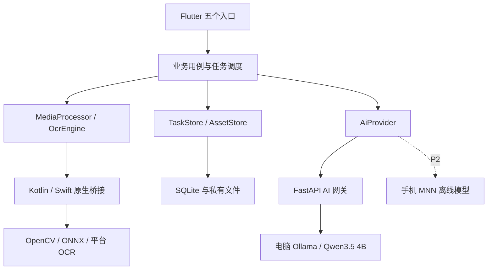
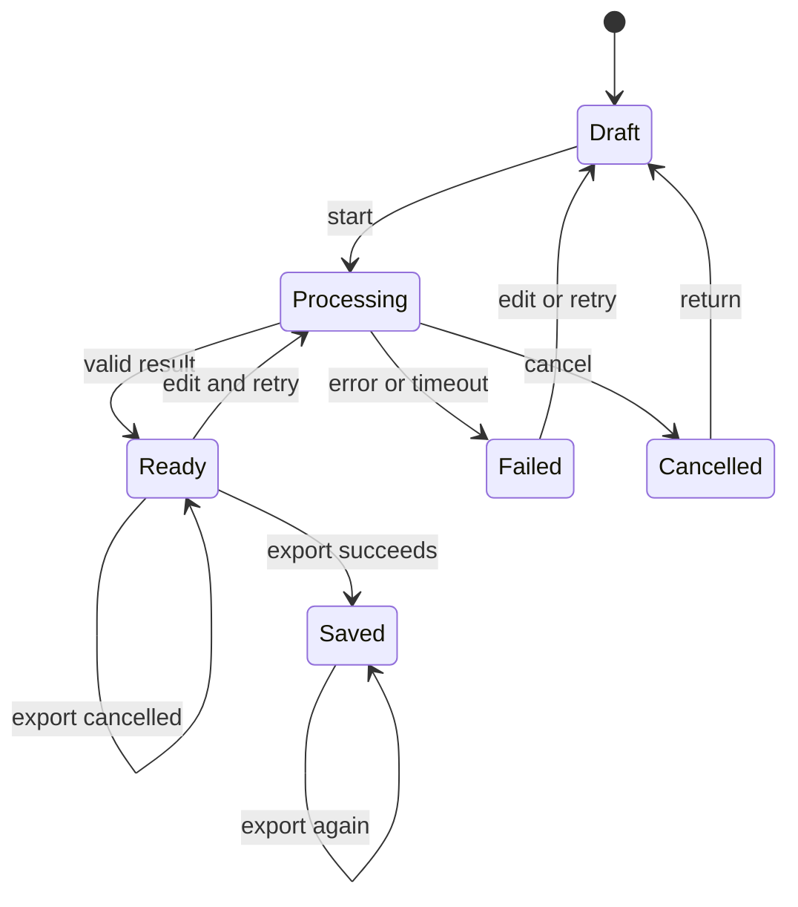

# 日常照片与文件工具箱：技术选型与仓库架构方案

| 项目 | 内容 |
|---|---|
| 版本 | V1.0 |
| 日期 | 2026-10-13 |
| 依据 | 《日常照片与文件工具箱 App 需求规格说明书》V1.0，489 行需求基线 |
| 输出范围 | 技术选择、运行架构、代码仓库结构、接口边界、数据管理、测试与打包方案 |
| 文档状态 | 技术设计建议稿；技术资料已复核，模型效果及性能尚未完成实机验证 |
| 首版功能 | 证件照、扫描识字、图片工具、拍照翻译、拍照问答 |
| 推荐形态 | Flutter 移动 App＋手机本地处理＋可选 AI 网关＋电脑本地 Qwen 服务 |
| 首发默认建议 | Android 先验证和发布，架构保留 iOS；该建议不代表用户已确认平台 |
| 后续方向 | 通过同一 AI 能力接口增加手机端离线推理，单独验证后发布 |

> 需求中的性能、CER、IoU、翻译和问答质量指标仍是验收建议目标。本方案没有对这些目标给出已达标承诺，也没有把某个技术“支持移动端”当作目标设备上的验证结果。

## 1. 推荐结论

采用单仓、多模块的工程组织方式：

- **客户端：** Flutter/Dart，Riverpod 管理状态与依赖，go_router 管理路由。
- **本地图像能力：** 自有 Flutter 原生插件，Pigeon 生成类型化桥接；Kotlin/Swift 负责系统能力和任务调度，共享 C++/OpenCV 处理图片。
- **OCR：** Android 首选 ML Kit 打包式中文/拉丁文字识别，iOS 首选 Apple Vision；通过同一 OCR 接口统一结果。
- **抠图：** 人像使用 MODNet，单主体物品使用 U²-Net 小模型 u2netp 作为初始候选；ONNX Runtime 执行。两者均须经过 M0 质量、耗时和转换一致性验证。
- **存储与导出：** Drift/SQLite 保存任务、参数、文字及结果索引；图片和 PDF 保存为文件；Dart pdf 生成 PDF。
- **AI 服务：** Python 3.12＋FastAPI＋Pydantic＋httpx，统一手机与模型之间的接口、认证、错误和流式响应。
- **电脑推理：** 首选原生 Ollama＋明确的 qwen3.5:4b 模型；手机端 Qwen 后续以 MNN 为首选验证候选。
- **仓库：** 一个移动应用、四个 Dart 包、一个共享 C++ 图像库、一个 AI 网关；使用统一接口和依赖规则保持模块边界。

该方案让图片处理、扫描、OCR 等基础任务在手机完成。AI 网关只参与用户主动触发的翻译、摘要和图片问答，不成为基础工具的运行前提。

## 2. 约束与设计假设

### 2.1 从需求继承的约束

| 约束 | 技术落实 |
|---|---|
| 五个首版入口 | 五个功能模块独立组织，共用输入、任务、导出和历史 |
| 单图暂定 20MB/2000万像素，扫描最多 20 页 | 输入验证、逐页处理、有限任务队列与内存监测 |
| JPG/PNG/PDF/TXT 输出 | 原生图片编码、Dart PDF 组装、UTF-8 文字导出 |
| 基础离线能力 | OCR 与小型图像模型随首版安装资源提供，不能首次使用才等待联网下载 |
| 中英印刷体 OCR、中英翻译 | 首版固定语言验证集，其他语言按 P1 单独验收 |
| 不覆盖原图 | 文件引用与输出分离，原子写入新文件 |
| 人像与物品抠图 | 分场景模型；支持人工修边，不依赖 Qwen 生成蒙版 |
| 取消、超时与晚到响应 | 任务标识、执行代次、状态机和输出提交检查 |
| 后续手机离线 Qwen | AiProvider 接口支持远端与端侧实现，首版端侧能力默认不可用 |
| 无账号、云同步和付费体系 | 本地数据、设备级服务凭证，不建设用户平台 |

### 2.2 本方案新增的默认建议

1. Android 首发验证，最低系统版本先按 Android 10/API 29 建立测试基线；最终在 M0 根据真实设备确定。
2. iOS 架构预留，验收基线建议 iOS 16 及以上；首版是否同时交付由平台决策确定。
3. 原生重任务同时执行 1 个，其他任务进入有限队列；不在 UI 主线程解码大图或推理。
4. 单机模型服务默认推理并发 1、等待队列上限 8、总请求期限 120 秒；均是可调工程配置。
5. 小型图像模型随 App 打包，完整 Qwen 权重不放入首版 App 安装包。
6. Mac 上优先原生运行 Ollama；网关可独立运行或容器化。若使用其他系统，仍保留同一网关接口。
7. 技术版本在 M0 验证后固定，禁止用“最新版本”作为可复现部署配置。

## 3. 客户端路线对比

| 路线 | 适配本产品的优势 | 主要成本 | 选择 |
|---|---|---|---|
| **Flutter＋自有原生插件** | 五个入口可共用界面与业务代码；图片编辑 UI 可控；通过平台桥接接入原生算法与模型 | 仍需维护 Kotlin、Swift 和 C++ 边界；需要实机性能验证 | **推荐** |
| Kotlin/Compose＋Swift/SwiftUI 双原生 | 系统相机、文件、Vision 与平台调试直接 | 双端界面及业务流程分别维护；跨端一致性测试较多 | 只做单平台或有双端团队时可选 |
| React Native 或基于 Web 的跨端方案 | JS/TS 或已有 Web 团队可复用经验 | 本产品的 OCR、抠图、大图处理仍需原生集成；WebView 方案不能直接承担所有本地能力 | 不作为当前默认方案 |

选择 Flutter 的依据是产品包含较多图片预览、参数编辑和原生计算，不是认为一个框架能自动解决算法、性能和端侧模型问题。Flutter 官方提供平台通道及 Pigeon 类型化代码生成方式，[T-01]。

## 4. 详细技术选型

| 能力 | 推荐技术 | 决策状态 | 替代/备注 |
|---|---|---|---|
| 移动界面 | Flutter 当前稳定 SDK；Dart 随 SDK | 推荐采用 | M0 固定准确 SDK 版本 |
| 状态、依赖注入 | flutter_riverpod | 推荐采用 | 不额外引入第二套状态框架 |
| 路由 | go_router | 推荐采用 | 统一处理入口、结果、设置与历史路由 |
| 摄影 | camera | 推荐采用 | 生命周期、方向、权限需实机测试 |
| 相册图片选择 | image_picker | 推荐采用 | 选后转成应用可读取引用，处理授权失效 |
| 文件选择/导出 | file_selector＋原生 FileAccessPort | 推荐，版本须 POC 冻结 | 手机保存流程由原生适配补足，不能假设选择器支持所有保存操作 |
| 系统分享 | share_plus | 推荐采用 | 分享和保存是两种独立状态 |
| 网络请求 | Dio | 推荐采用 | 超时、取消、SSE 增量解析 |
| 原生桥接 | Pigeon＋Kotlin/Swift | 推荐采用 | 不跨桥传递整张原尺寸 RGBA 数组 |
| 共享图片算法 | OpenCV 4.x/C++17 | 推荐采用 | 模板、裁剪、透视、拼图、遮盖和背景合成 |
| 图片编解码/元数据 | Android 原生编解码/ExifInterface；iOS ImageIO | 推荐采用 | 校正方向、清理 GPS、写入必要 DPI |
| Android OCR | ML Kit bundled 中文与拉丁文字模型 | 首选，须 M0 验证 | 无 GMS、首次断网安装和 CER 是验证门槛 |
| iOS OCR | Apple Vision，VNRecognizeTextRequest | 首选，须 M0 验证 | 实机查询支持语言和请求版本；不假设各 OS 一致 |
| OCR 备用路线 | PP-OCR mobile＋ONNX Runtime | 条件候选 | 首选失败时验证 Paddle→ONNX、词典、算子和后处理 |
| 人像抠图 | MODNet→ONNX | 模型候选，需质量验证 | 官方提供 RGB 人像 matting 及 ONNX 转换入口 |
| 单主体物品抠图 | u2netp→ONNX | 模型候选，需质量验证 | 小体积有利于端侧起步；不承诺细发丝或透明物体表现 |
| 小模型推理 | ONNX Runtime 原生移动库 | 推荐采用 | 先建立 CPU 基线，再验证加速后端 |
| 本地索引 | Drift/SQLite | 推荐采用 | 只存元数据与文字，不用大图 BLOB |
| 本地文件 | 应用私有目录＋外部导出副本 | 推荐采用 | 明确文件所有权、引用与清理策略 |
| PDF 生成 | Dart pdf | 推荐采用 | 组装已处理页面；PDF 内存占用须实测 |
| 安全凭证 | flutter_secure_storage/平台安全存储 | 推荐采用 | 模型服务凭证不进入 SQLite、日志或导出 |
| 网关 | FastAPI＋Pydantic＋httpx | 推荐采用 | 一个轻量服务即可 |
| 电脑模型运行 | Ollama＋qwen3.5:4b | 首选，须视觉端到端验证 | 记录模型 digest，不使用浮动 latest |
| Apple Silicon 可选运行 | MLX-VLM | 备用候选 | 只有 Ollama 的性能/兼容性需要替代时引入 |
| 后续手机大模型 | MNN＋适配后的 Qwen 模型包 | P2 候选 | 单独验证视觉组件、上下文、内存、发热与质量 |

资料依据见第 19 节。Apple/Google SDK 有各自使用条款，不将其标注成 Apache/MIT 开源库；运行时与模型权重的授权分别记录。

## 5. 运行架构与依赖边界

### 5.1 运行架构

- 本地图片链路不经过 AI 网关。
- 网关负责认证、输入限额、模型适配、错误与响应协议，不保存用户业务档案。
- SQLite、图片、PDF、文字与历史记录由手机管理。
- 同一 AiProvider 上层接口选择远端或端侧实现；端侧尚未完成时明确报告不可用。

### 5.2 代码依赖方向

| 模块 | 允许依赖 | 禁止依赖 |
|---|---|---|
| apps/mobile | app_domain、media_native、local_store、ai_provider、Flutter UI 包 | 直接调用 Ollama 原始接口或读取其他模块内部实现 |
| app_domain | Dart 基础类型和纯 Dart 依赖 | Flutter Widget、Dio、Drift、平台通道、OpenCV |
| media_native | app_domain 的数据/端口类型、Pigeon、平台与 C++ 库 | 页面组件、AI 网关、业务数据库 |
| local_store | app_domain 的存储端口、Drift、平台文件适配 | 页面状态、模型推理和图像算法 |
| ai_provider | app_domain 的 AI 端口、Dio、生成的接口 DTO | 业务数据库表、图片 UI、扫描算法 |
| native/media_core | OpenCV、ONNX Runtime、标准 C++ | Flutter 页面、HTTP 网关、SQLite 业务表 |
| services/ai_gateway | 网关自身 API/服务/模型适配模块 | 手机本地文件、Flutter 包、用户业务数据库 |

应用在启动时组装具体实现。业务用例通过端口调用能力，各能力模块只返回标准结果和错误，不替页面决定导航或弹窗。

### 5.3 关键接口

以下是接口职责说明，不是已经生成的产品代码。

| 接口 | 主要操作 | 输入/输出边界 |
|---|---|---|
| MediaProcessor | crop、resize、compress、scan、compose、redact、matte | 文件引用＋参数 → 输出文件引用＋元数据＋处理记录 |
| OcrEngine | recognize、supportedLanguages | 文件引用＋区域＋语言 → 文本块、段落、坐标及可用置信度 |
| PdfExporter | scannedPages、photoPrintSheet | 按顺序的页面文件/版式 → PDF 文件与页数、纸张尺寸 |
| AssetStore | import、resolve、retain、release、export | 访问引用与应用内副本的生命周期 |
| FileAccessPort | select、open、copy、save、resolvePermission | 系统选择/授权/保存结果，具体实现由原生适配提供 |
| TaskStore | create、update、complete、list、remove | 状态、参数、结果、错误及事务 |
| AiProvider | capabilities、translate、visionChat、cancel | 任务上下文 → 文本/流事件；执行方式可替换 |
| ModelRegistry | resolve、verify、load、unload | 模型类型、版本、真实校验值与支持能力 |

PDF 导出可以在 local_store 包的独立导出模块实现，不为单一 PDF 能力额外拆分一个 Dart 包。

## 6. 仓库组织方案

### 6.1 单仓与应用名称

仓库建议名称：daily-photo-toolbox。

采用单仓管理 App、共享能力、模型工具、网关与文档。代码逻辑分模块，运行时只有一个移动 App、一个可选网关和可配置的模型运行服务。

首版不引入微服务拆分、服务注册中心或独立业务数据库。网关内部通过模块区分 API、任务调度和模型适配。

### 6.2 根目录与职责

下表中的目录是拟建设的仓库结构，不表示这些产品代码已经创建。

| 路径 | 职责 | 阶段 |
|---|---|---|
| README.md | 项目入口、运行方式、限制和验证状态 | 首版 |
| AGENTS.md | AI 辅助开发规则、模块边界、需求编号与验证要求 | 首版 |
| pubspec.yaml | Dart pub workspace 定义 | 首版 |
| pubspec.lock | 所有 Dart workspace 包的共享锁文件 | 首版 |
| apps/mobile/ | Flutter App、平台宿主工程、功能页面与装配 | 首版 |
| packages/app_domain/ | 纯 Dart 领域模型、端口、用例、状态机和业务规则 | 首版 |
| packages/media_native/ | 自有 Flutter 原生插件、OCR 和图像/文件能力桥接 | 首版 |
| packages/local_store/ | Drift 数据库、文件索引、历史、文字和 PDF 导出 | 首版 |
| packages/ai_provider/ | 统一 AI 适配、网关客户端、响应/错误映射 | 首版 |
| native/media_core/ | 共享 C++ OpenCV 和 ONNX 图像核心 | 首版 |
| services/ai_gateway/ | FastAPI 网关与 Ollama 适配 | 首版 |
| contracts/http/ | 网关 OpenAPI 快照与契约样本 | 首版 |
| models/ | 模型登记、转换记录、校验和资源生成规则 | 首版 |
| tools/model_export/ | 模型转换与转换前后结果比较工具 | M0 |
| tools/benchmarks/ | 固定样本的性能与质量评估工具 | M0 起 |
| testdata/ | 人工/合成测试材料、标注、预期结果及样本说明 | M0 起 |
| docs/requirements/ | 原需求基线和后续变更 | 首版 |
| docs/architecture/ | 本技术方案、模块说明和运行流程 | 首版 |
| docs/adr/ | 关键架构选择、变更原因与验证证据 | 首版 |
| scripts/ | 生成、检查、测试、打包等统一开发入口 | 首版 |
| infra/ | 网关容器配置、开发配置和发布配置说明 | 首版 |
| .github/workflows/ | 分层 CI、契约检查、平台构建和制品收集 | 首版 |
| third_party/ | 依赖授权、模型来源及通知文件 | 首版 |
| build_artifacts/ | 本地生成的测试报告和安装包；不纳入普通 Git 提交 | 首版 |

Dart 使用 pub workspace 的统一依赖解析与根锁文件，[T-02]。Python 网关和模型转换工具使用各自的环境与锁文件，避免把 PyTorch/模型转换依赖装入运行网关。

### 6.3 Flutter App 内部结构

| 路径 | 内容 |
|---|---|
| apps/mobile/lib/app/ | bootstrap、router、provider 装配、主题、启动恢复 |
| apps/mobile/lib/features/home/ | 五入口、最近记录 |
| apps/mobile/lib/features/identity_photo/ | 人物选区、底色、尺寸、压缩、打印排版 UI |
| apps/mobile/lib/features/scanner/ | 扫描页列表、四角调整、滤镜、OCR 编辑、PDF 导出 UI |
| apps/mobile/lib/features/image_tools/ | 压缩、裁剪、拼图、长截图、打码、抠图 UI |
| apps/mobile/lib/features/translation/ | 原文编辑、语言选择、译文和保存 UI |
| apps/mobile/lib/features/vision_chat/ | 选图、快捷问题、追问、流式回答 UI |
| apps/mobile/lib/features/history/ | 任务检索、重新打开、再次导出、记录删除 |
| apps/mobile/lib/features/settings/ | AI 连接、缓存、权限、版本 UI |
| apps/mobile/lib/shared/widgets/ | 图片视口、区域选择、进度、结果信息、错误组件 |
| apps/mobile/lib/shared/controllers/ | 跨入口输入/导出控制器；不放具体算法 |
| apps/mobile/assets/templates/ | 证件照和打印排版模板及模板说明 |
| apps/mobile/assets/models/ | 构建阶段生成的小模型资源，不手工维护重复副本 |
| apps/mobile/test/ | Widget、路由、控制器测试 |
| apps/mobile/integration_test/ | 实机流程与导出验证 |
| apps/mobile/android/ | Android 宿主、权限、构建/签名配置 |
| apps/mobile/ios/ | iOS 宿主、权限、构建/签名配置 |

每个功能优先采用 presentation 与 controller 两层组织；业务规则与处理用例位于 app_domain。避免在每个功能下再次复制完整基础设施层。

### 6.4 Dart 包与原生结构

| 路径 | 内容 |
|---|---|
| packages/app_domain/lib/src/models/ | AssetRef、MediaMetadata、EditPlan、Task、OcrResult、AiEvent |
| packages/app_domain/lib/src/ports/ | MediaProcessor、OcrEngine、AssetStore、TaskStore、PdfExporter、AiProvider |
| packages/app_domain/lib/src/use_cases/ | 证件照、扫描、图片工具、翻译和问答的业务用例 |
| packages/app_domain/lib/src/policies/ | 像素/字节边界、模板、任务状态和输出有效性规则 |
| packages/app_domain/lib/src/errors/ | 标准错误码与可恢复信息 |
| packages/media_native/pigeons/ | 类型化原生桥接定义，作为原生契约源 |
| packages/media_native/lib/src/ | Dart 适配器及生成的桥接代码 |
| packages/media_native/android/src/main/ | Kotlin OCR、编解码、URI/权限适配、JNI 和工作队列 |
| packages/media_native/ios/Classes/ | Swift OCR/文件适配、后台队列与 Objective-C++ 包装 |
| native/media_core/include/ | 稳定的图像核心调用边界和结果类型 |
| native/media_core/src/transforms/ | 缩放、旋转、裁剪、尺寸与颜色变换 |
| native/media_core/src/document/ | 纸张检测、透视矫正、滤镜和扫描增强 |
| native/media_core/src/composition/ | 拼图、遮盖、alpha 合成和背景替换 |
| native/media_core/src/inference/ | ONNX 会话、预处理、MODNet/u2netp 后处理 |
| native/media_core/tests/ | 输入边界、变换坐标、合成和实际输出测试 |
| packages/local_store/lib/src/database/ | 表结构、DAO、迁移与数据库事务 |
| packages/local_store/lib/src/assets/ | 文件引用、导入、缓存、导出与清理 |
| packages/local_store/lib/src/export/ | PDF 组装、打印排版 PDF、UTF-8 TXT |
| packages/ai_provider/lib/src/remote/ | 网关连接、SSE、超时、错误映射 |
| packages/ai_provider/lib/src/generated/ | 从 OpenAPI 生成的网络 DTO/客户端代码 |
| packages/ai_provider/lib/src/edge/ | P2 接口适配位置；首版只报告未安装/不支持，不引入 MNN 依赖 |

local_store 不直接依赖 media_native 包。平台文件选择、读写与外部导出通过 app_domain 中的 FileAccessPort 注入，具体实现放在 media_native，应用启动时组装。

### 6.5 AI 网关内部结构

| 路径 | 内容 |
|---|---|
| services/ai_gateway/pyproject.toml | 网关运行与测试依赖 |
| services/ai_gateway/uv.lock | 网关独立锁文件 |
| services/ai_gateway/src/ai_gateway/api/ | health、capabilities、translate、vision_chat、cancel |
| services/ai_gateway/src/ai_gateway/schemas/ | Pydantic 请求、结果、错误和事件定义 |
| services/ai_gateway/src/ai_gateway/services/ | 并发限额、期限、请求注册、取消与输入校验 |
| services/ai_gateway/src/ai_gateway/providers/ | Ollama 适配；以后可替换为其他推理后端 |
| services/ai_gateway/src/ai_gateway/prompts/ | 版本化翻译、图片解释、信息不足处理提示 |
| services/ai_gateway/src/ai_gateway/config/ | 环境变量与结构化配置 |
| services/ai_gateway/tests/ | API、限额、错误、流式和适配器测试 |
| tools/model_export/pyproject.toml | 单独的 PyTorch/ONNX 转换环境 |
| tools/model_export/uv.lock | 模型工具独立锁文件 |
| tools/model_export/reports/ | 转换参数、算子、数值/蒙版差异记录 |

## 7. 契约、类型与生成代码

### 7.1 两类契约分别管理

| 契约 | 唯一源 | 派生物 | 规则 |
|---|---|---|---|
| App ↔ 原生能力 | packages/media_native/pigeons/ 内的 Pigeon 定义 | Dart、Kotlin、Swift 桥接代码 | 不手改生成代码；CI 检查重新生成后的差异 |
| App ↔ AI 网关 | 网关 Pydantic/API 定义 | contracts/http/openapi.json、Dart 网络 DTO | OpenAPI 是生成快照，不与 API 维护两份独立字段定义 |
| 业务领域模型 | app_domain 中的纯 Dart 类型 | UI/持久化/网络的显式映射 | 不把网络 DTO 或 Drift 表类型直接当作领域模型 |

生成代码随仓库提交以便构建，但源定义和生成工具版本必须固定。

### 7.2 原生调用规则

- Flutter 提交文件引用、编辑参数、jobId 和 attemptId；原生返回接受状态，并通过回调报告进度/结果。
- 原生重计算在线程池/工作队列执行；平台通道回调按平台要求切回适当线程。
- 以文件引用或受控原生缓存标识传输结果，禁止频繁跨通道复制整张原尺寸图片。
- 预览图允许较低分辨率；导出按用户参数从原材料重新计算。
- 所有结果包含执行代次；只接收当前未取消任务的当前代次输出。
- 文件读写必须限定于用户授权输入或 App 自有路径，不能让不受信任参数指定任意系统路径。

### 7.3 统一坐标与像素约定

1. 先将输入 EXIF 方向归一化，形成宽高已确定的规范图像。
2. 所有业务坐标采用左上角原点，x 向右、y 向下。
3. 页面交互保存归一化坐标；原生执行时映射到当前规范图像像素。
4. 保存旋转、裁剪、透视及缩放的变换关系，确保 OCR 框、遮盖和蒙版不会错位。
5. iOS Vision 与 Android OCR 返回的坐标在适配层转换，不将平台坐标差异暴露给 UI。
6. 模型输出软 alpha 蒙版，统一明确 alpha 范围和 RGBA 合成约定；不使用任意阈值把人像发丝全部二值化。
7. 导出前真正合成裁剪、背景与遮盖，不只保存 UI 叠层截图。

## 8. 版本与模型资源管理

### 8.1 版本冻结

| 项目 | 冻结方式 |
|---|---|
| Flutter/Dart | M0 记录准确 SDK 版本；CI 使用同一版本；Dart 以该 Flutter SDK 配套版本为准 |
| Dart 包 | 根 pubspec.lock；workspace 包统一依赖解析 |
| Pigeon/OpenAPI 生成工具 | 明确工具版本，并用 CI 重新生成检查 |
| Android/iOS 构建链 | Gradle wrapper、插件、NDK、编译 SDK、Xcode/工具链版本记录；按发布目标验证 |
| C++ 依赖 | OpenCV 与 ONNX Runtime 固定 release/tag 和制品校验 |
| Python 网关/模型工具 | Python 3.12 系列与各自 uv.lock，保持两个环境分离 |
| Ollama | 固定安装版本与已验证模型 digest，不依赖浮动标签解析结果 |
| 模型预后处理 | 与权重版本一起冻结 RGB/BGR、缩放、归一化、字典及输出解释 |

### 8.2 模型登记字段

models/registry.yaml 记录如下字段；这里定义字段要求，不伪造尚未下载的校验值。

| 字段 | 用途 |
|---|---|
| model_id / task / status | 标识、任务类型、candidate 或 approved |
| upstream / upstream_revision | 官方来源和固定版本/提交 |
| source_license / notices | 权重授权及通知文件 |
| source_sha256 | 原始权重真实校验值 |
| converted_sha256 / format | 转换后制品校验和与格式 |
| input_shape / color_order / normalization | 完整预处理说明 |
| output_schema / postprocess_version | 蒙版、字典或文字后处理约定 |
| runtime_version / operators | 已验证运行时及算子要求 |
| file_size / peak_memory / device | 实测文件体积、内存、设备 |
| evaluation_report | CER/IoU/耗时及转换对照报告 |
| packaged / download_policy | 随包、构建下载或后续可选模型包策略 |

### 8.3 权重与数据规则

- 普通 Git 保存代码、模板、登记、授权和小型测试样本；不直接提交完整 Qwen 权重。
- 小型抠图权重由构建脚本从已固定来源取得、校验后打入 App；不会要求用户首次联网才能使用基础抠图。
- 模型制品可进入专用制品存储；登记文件中的真实校验值与构建校验保证复现。
- 自动化构建不把未 approved 的候选模型包装成“已验证”版本。
- 业务用户照片、真实凭证、服务密钥和个人相册不进入测试仓库。
- 对 MODNet 使用官方允许的代码与模型；u2netp 来源、转换与权重授权单独登记。

## 9. 本地图像处理的落地方式

### 9.1 大图与任务调度

- 规范图像以文件/原生缓存引用管理；一张 1200 万像素 RGBA 图仅像素数据就约 48MB，不能按 JPEG 压缩体积估计内存。
- UI 预览使用缩略图，参数与绘制坐标独立保存；导出时回到规范输入计算。
- 原生重任务默认串行执行，同时只保留必要源图、工作图和输出缓冲。
- 20 页扫描逐页矫正并生成压缩页面，PDF 阶段使用这些页面文件，不同时解码全部原图。
- 大图拼接按输出像素上限计算缩放，必要时分块合成，避免同存多份原始位图。
- PDF 库可能仍保存整份文档的压缩资源和对象；不将逐页处理等同于 PDF 写出天然恒定内存。
- 取消采用任务标记和阶段边界检查。无法立即打断的单个底层算子完成后丢弃结果；不得承诺瞬间终止所有底层计算。
- 所有原生输出写入任务临时目录；只有当前任务和代次仍有效时才能提交结果。

### 9.2 证件照与背景处理

流程：读取并校正方向 → 用户选择人物/裁剪区域 → MODNet 生成软 alpha → 手动修边 → 与底色合成 → 按模板裁剪/缩放 → 原生编码 → 检查字节数与像素 → 导出。

- 多人照片首版允许用户裁剪/修边排除其他人物，不承诺 MODNet 自动返回每个人的实例蒙版。
- 背景色填充与用户选择一致，源人物像素保留，不用 Qwen 重绘人脸。
- 模板以物理尺寸、像素、DPI、底色和说明组织，不伪造“机构官方认证”。
- JPG 编码和 DPI 元数据写入在原生侧完成；PNG 透明度在导出路径保留。
- 人像 MODNet 与物品 u2netp 是不同能力实现；不要仅用人像模型完成商品抠图。

模型支持和授权参考 [T-11]、[T-12]。物品模型若未通过需求的 20 张物品样本测试，应比较完整 U²-Net 或其他明确授权模型，评估质量与资源后再决定；不能把候选模型上线等同于 P0 已验收。

### 9.3 压缩、尺寸与格式

1. 编辑与导出共享同一参数计划，避免预览与最终导出走不同的处理逻辑。
2. 从规范源图处理一次，搜索可用的 JPEG 编码质量；不连续对上次压缩结果再压缩。
3. 用最终文件字节数确认大小达标，不仅根据编码质量预测。
4. 尺寸被锁定时不能为满足 KB 上限偷偷降低分辨率。
5. PNG 保留透明度；转 JPG 需明确选择背景。无法满足透明度和大小约束时返回业务错误。
6. 自定义压缩、像素上限与 KB=1024 字节规则从 app_domain 中读取，多个入口不各自定义一套数值。

### 9.4 扫描与 OCR

扫描采用 OpenCV 的传统图像处理：灰度/边缘/轮廓检测形成候选四角，进行透视矫正与效果预览。无法形成可靠四角时进入手动调整。

Android OCR 采用打包式文字识别依赖，不能替换为 Google Play Services 下载式依赖后仍称为首次离线可用。官方区分模型随应用打包与通过 Play Services 下载的方式，[T-07]、[T-08]。

iOS 使用 Vision 识别请求，查询当前系统支持语言后配置中英识别，并统一坐标与阅读顺序，[T-09]。

两端用同一标注集分别评估 CER。若 Android 的地区、无 GMS 或首次离线测试不通过，才启动 PP-OCR mobile 备用路线；需重新验证转换、词典、预后处理、体积和性能，不只是替换文件名。

## 10. AI 网关与模型服务设计

### 10.1 推理服务选择

Ollama 官方 qwen3.5 模型页列出 4b 的文字与图像输入，当前页面不同格式资源约 3.3–4.0GB；文件体积不等于运行内存。[T-18]

推荐前期使用明确的 qwen3.5:4b，并记录安装版本、模型 digest、视觉输入验证报告：

- 网关通过 Ollama 原生聊天接口调用；视觉消息包含 images 数据。
- 网关发送受控的图像字节编码，不让用户提供任意外部图片 URL 由服务器下载。
- 流式响应从 Ollama 的 NDJSON 映射到 App 使用的统一 SSE 事件。
- thinking 配置按模型版本实测；App 只显示最终回答内容字段，避免把模型推理字段直接作为用户答案。
- 初始上下文建议从 8192 tokens 验证，而不是直接启用模型宣称的最大上下文。
- 首版输出长度建议图片问答 512 tokens、翻译每段 1024 tokens，再用固定样本校准。
- 不能静默截断当前问题或待翻译原文；超长原文分段，过长对话提示新建会话/减少历史。
- 单图五轮追问是必测场景，需验证图像与历史如何占用上下文，不能仅凭 token 配置推断必然可用。
- 若使用 Apple Silicon 电脑，原生 Ollama 是默认路线；MLX-VLM 作为备用，不同时维护两个必需后端。
- Linux/NVIDIA 规模化部署可后续增加其他 Provider，不改变 App 功能入口。

参数是本产品的初始配置建议，不是 Ollama 的默认值，也不是需求质量已经达标的证明。[T-19]、[T-20]

### 10.2 网关 API

请求服务认证使用用户配置的设备/服务凭证。首版 API 固定版本路径，不建立用户注册体系。

| 方法与路径 | 用途 | 主要输入/输出 |
|---|---|---|
| GET /health/live | 进程存活检查 | 不返回密钥和内部路径 |
| GET /health/ready | 推理服务就绪检查 | 模型存在、连接情况与最近能力验证状态 |
| GET /v1/capabilities | 支持能力 | apiVersion、textTranslation、visionChat、modelId、限制与验证状态 |
| POST /v1/translate | 中英翻译 | requestId、原文、源/目标语言 → 译文与完成状态 |
| POST /v1/vision/chat | 图片问答 | multipart 图片＋问题/受限历史＋requestId → SSE 事件 |
| POST /v1/requests/{requestId}/cancel | 尽力取消模型请求 | 返回取消已登记，不宣称上游立即停止计算 |

约定：

- requestId 由调用方生成，网关校验并绑定当前凭证，不允许取消其他凭证的请求。
- 图片请求检查编码体积、真实格式、像素数和解码后大小，拒绝损坏与超限输入。
- 翻译只需要文字时不上传图片；图片问答只上传当前选定图片，不上传整个相册。
- ready/capabilities 不因模型名包含“Qwen”就报告视觉链路已验证；以实际图像自测结果为准。
- 首版网关以单 worker 运行，请求表、取消标记和信号量保存在该 worker 内存。
- 增加多 worker/多实例前，需要共享请求状态或明确路由策略，不能直接扩 worker 后保持现有取消语义。
- 网络重试不自动重复推理；已接收的重复 requestId 返回冲突/当前状态，不启动第二份。
- 网关完成与手机保存完成分开，服务端不替手机记录“已保存”。

### 10.3 响应与错误

| 字段/事件 | 定义 |
|---|---|
| requestId / sequence | 请求与事件顺序，用于过滤重复/晚到事件 |
| accepted | 校验通过、请求已进入处理流程 |
| delta | 本次增量文本，不保证等于完整句子 |
| completed | 明确完成，包含最终结果/结束原因 |
| failed | 明确失败，包含稳定错误码 |
| cancelled | 已登记取消；App 停止使用后续结果 |
| error.code / retryable | 机器可读错误与能否手动重试 |
| error.messageKey | App 将其映射为清楚的中文提示，不展示内部堆栈 |

错误码建议：INVALID_INPUT、LIMIT_EXCEEDED、PERMISSION_DENIED、LOW_STORAGE、TARGET_SIZE_UNREACHABLE、OCR_NO_TEXT、MODEL_NOT_READY、MODEL_IMAGE_UNSUPPORTED、AUTH_FAILED、NETWORK_ERROR、TIMEOUT、CANCELLED、UPSTREAM_BAD_RESPONSE。

- 状态码与错误码分开维护；包括参数错误、未认证、超限、队列满和上游不可用等情况。
- SSE 与 NDJSON 必须按缓冲后的完整事件/完整行解析，不能把每个 TCP 数据块都当作独立 JSON。
- 未收到 completed 的答案标记为未完成；连接关闭不能自动视为回答成功。
- HTTP 断开和模型真正停止计算是不同事实；App 必须丢弃取消后的输出，网关尽力取消上游并记录真实结果。
- 上游连接结束前不提前释放相应工作资源；不因取消误把残留推理当作新并发额度。

### 10.4 网络与开发配置

| 环境 | 模型服务 | 网关 | 手机配置 |
|---|---|---|---|
| 本地开发 | 电脑原生 Ollama | 电脑指定局域网地址 | debug 配置允许访问该开发地址，使用开发凭证 |
| 内部测试/发布 | 已验证推理后端 | HTTPS 入口，校验证书 | 只连接用户配置的服务，不关闭证书校验 |
| 未来端侧 | 手机内适配模型与 MNN | 此模式无需网关 | 选择已安装端侧能力，基础工具始终可用 |

手机 localhost 指手机自身，不能用于连接电脑服务。电脑模型可以仅监听回环地址，由网关转发。

macOS 开发时将模型推理优先放在宿主机原生进程；不要把“网关已容器化”理解为模型已经具备容器内 GPU 加速。

## 11. 本地数据与一致性

### 11.1 数据表

| 表 | 主要字段 | 说明 |
|---|---|---|
| assets | id、sourceKind、accessRef、ownedPath、width、height、byteSize、refCount | 区分外部引用与应用自有副本 |
| tasks | id、feature、state、attemptId、createdAt、updatedAt、errorCode | 统一状态与执行代次 |
| edit_plans | taskId、schemaVersion、parametersJson、sourceTransform | 可恢复编辑与参数版本 |
| results | id、taskId、kind、ownedPath、metadata、generationState | 应用内结果与生成完成状态 |
| exports | id、resultId、destinationKind、destinationRef、status、completedAt | 记录外部保存，不把分享等同保存 |
| text_results | taskId、sourceText、editedText、translatedText、languages | OCR、修改稿与译文分开 |
| conversations | id、assetId、createdAt、providerKind | 更换图片创建新会话 |
| messages | conversationId、role、text、completionState、requestId | 明确完整/未完成输出 |

服务密钥不进入这些表。真实大图和 PDF 以文件保存，不放入 SQLite BLOB。

### 11.2 文件写入与恢复

1. 输入优先保存持久可访问引用；平台无法持久引用时导入应用私有副本并记录所有权。
2. 输出先写同文件系统的临时文件，检查内容、尺寸、大小后原子重命名为正式应用内结果。
3. 文件与 SQLite 不属于同一个原子事务：结果正式写入后提交数据库；失败时登记清理/恢复任务。
4. 外部导出成功后单独写 exports；用户取消系统文件保存窗口不算保存成功。
5. 启动时核对处理中/提交中任务、临时文件和结果记录，区分可恢复结果与需要重做的部分。
6. 取消或失败清理专属临时文件；共用资源通过引用计数/实际关联检查后清理。
7. 删除历史不删除系统相册和用户导出目录的副本。
8. AI 请求在 App 被系统回收后默认标为中断，允许用户重试，不假装原请求仍可恢复。

### 11.3 任务状态提交

任何进度、结果和导出提交都同时检查 taskId、attemptId 与当前状态。任务的前一次晚到结果不能覆盖用户当前修改后的结果。

## 12. 权限、隐私与观测

| 事项 | 实现要求 |
|---|---|
| 相机与照片 | 按操作申请权限；支持有限照片授权和文件选择降级 |
| 外部保存 | 原生接口区分用户取消、权限拒绝与真实保存成功 |
| 文件范围 | 原生层检查授权引用/App 自有路径，不接受任意系统文件地址 |
| 本地基础工具 | 不向模型服务发送图片；网络检查纳入实机测试 |
| AI 请求 | 用户触发后发送必要文字/图片；不偷偷切换第三方服务 |
| 凭证 | 平台安全存储；不进入日志、测试样本、普通配置提交和导出 |
| 元数据 | 默认去除 GPS；按需求保留/写入方向与打印 DPI |
| 服务端材料 | 请求临时材料在完成、失败或取消后清理；不建用户照片档案 |
| 日志 | 记录 requestId、错误码、耗时、模型/算法版本；不记录密钥、原图、完整 OCR 内容或完整问答 |
| 性能报告 | 分解读取、预处理、推理、编码、上传与等待，区分冷/热启动和排队耗时 |

平台安全存储用于凭证，不代表整个 SQLite 数据库和图片目录已经自动加密。数据管理页面应能明确展示应用内结果和可清理缓存。

## 13. 开发环境、构建与交付

### 13.1 开发环境

| 环境 | 用途 | 约定 |
|---|---|---|
| Android 开发机 | Flutter、Android SDK、JDK、NDK、CMake | 工具版本与依赖组合在 M0 编译验证后固定 |
| macOS 开发机 | Android 开发及未来 iOS 编译、Xcode、原生模型服务 | iOS 构建使用 macOS；不把模拟器结果当作模型实机性能 |
| 模型电脑 | Ollama 与已验证 Qwen3.5 4B | 单独记录模型常驻内存、首答/总耗时与上下文 |
| Python 网关环境 | FastAPI/httpx/测试 | 使用独立 uv.lock，不安装移动图像训练依赖 |
| 模型转换环境 | PyTorch/ONNX 导出与对照 | 独立工具环境；不照搬老模型仓库的过时依赖到运行服务 |

若使用 16GB Apple Silicon 电脑，可作为 4B 量化模型的 POC 起点；仍需测量系统可用内存与具体芯片表现，不作普遍性能保证。原生 Ollama 的硬件支持说明见 [T-21]。

### 13.2 统一开发入口

以下为需要在实施阶段建立的脚本职责，不是本次已提供的可执行命令。

| 脚本职责 | 工作内容 |
|---|---|
| bootstrap | 检查 SDK、锁文件、Python/NDK/CMake 和平台工具 |
| generate_native_contracts | 从 Pigeon 生成 Dart/Kotlin/Swift |
| generate_http_contracts | 从网关生成 OpenAPI，再生成 Dart 网络类型 |
| prepare_model_assets | 从 approved 登记取得模型、校验、生成 App 资源 |
| check_boundaries | 检查领域包不导入 UI/HTTP/数据库/平台实现 |
| run_unit_checks | Dart、Python、C++ 的必要单元及规则测试 |
| run_device_checks | 权限、OCR、抠图、PDF、导出和内存实机验证 |
| evaluate_models | CER、IoU、翻译/问答质量、转换一致性 |
| package_android / package_ios | 平台安装包、签名与资源清单 |
| collect_reports | 收集版本、设备、需求覆盖、性能/质量和已知问题 |

### 13.3 CI 层次

| 层次 | 必需检查 | 环境 |
|---|---|---|
| 静态与契约 | 格式/分析、依赖边界、生成代码差异、OpenAPI 兼容性、模型登记格式 | Linux/macOS |
| 业务与存储 | 状态机、KB/像素约束、输出提交、引用清理、数据库迁移 | Dart/Flutter 测试 |
| 原生图像 | 坐标/颜色/alpha、输出尺寸、错误输入；不以 UI 截图代替实际导出 | C++ 与平台测试 |
| 网关 | 认证、限额、期限、取消、NDJSON/SSE 分包、重复请求和上游失败 | Python 测试 |
| Android 构建 | APK/AAB 构建、模型资源与签名配置检查 | Android 构建环境 |
| iOS 构建 | Swift/Objective-C++ 链接、权限、资源与签名配置 | macOS，iOS 纳入交付后启用 |
| 设备验收 | 首次断网安装、无 GMS OCR、模型实际调用、20 页和大图压力 | 目标真机 |
| 发布制品 | 安装包、版本与模型清单、测试报告、已知限制、授权通知 | 发布流水线 |

Fake/Mock 只用于隔离测试与错误路径，不进入正式 Provider 装配。视觉支持、模型质量、性能和首次离线能力必须使用真实设备、真实资源验证。

### 13.4 打包与配置

- debug 与 release 分开配置服务地址、日志与开发网络例外。
- 不将开发机器 IP、测试凭证或固定个人服务密钥硬编码到发布包。
- 首版安装资源包含 approved 小模型及 Android bundled OCR，不包含完整 Qwen 大模型。
- Android 相册保存经平台接口完成；iOS 经 Photos；文件导出通过原生系统流程反馈结果。
- 按本次核查的平台矩阵，file_selector 的“选择保存位置”不支持 Android/iOS；它用于文件选择，手机保存窗口由原生 FileAccessPort 实现并验证。[T-23]
- share_plus 是系统分享能力，不代替保存 API。[T-22]
- 安装包检查实际模型资源是否存在、校验是否匹配、断网能否第一次运行。
- 模型服务发布和 App 发布单独记录版本；API 兼容版本与模型能力可由设置页查看。
- 本地验证阶段以可安装测试包为交付；商店发布需要另行确定分发渠道与签名配置。

## 14. M0 验证项目与失败处理

| 验证项 | 必须取得的证据 | 未通过时的处理 |
|---|---|---|
| Flutter↔原生 | 真实选图、处理、预览、保存；取消后晚到输出被丢弃 | 修正桥接、线程与坐标，不通过假结果绕过 |
| Android 本地 OCR | 无 GMS 真机、首次安装后断网，中英文本与 CER 报告 | 启动 PP-OCR mobile 备用 POC；重新验证转换、体积和速度 |
| iOS OCR | 目标 OS 的语言/版本能力，中英固定样本 | 明确最低系统/支持范围，或验证备用 OCR |
| 人像抠图 | 30 张样本，原权重/ONNX 对照、IoU、脸部完整性、耗时/内存 | 调整预后处理、修边流程或更换明确授权模型 |
| 物品抠图 | 20 张样本及独立结果，不能与人像平均值混算掩盖问题 | 比较更完整模型与资源预算；若变更首版范围，记录需求变更 |
| 扫描/PDF | 20 页真实流程、顺序、可打开性、物理打印尺寸和资源报告 | 优化逐页尺寸与编码策略，保持不丢页原则 |
| Qwen 视觉 | 手机→网关→真实 4B 模型，文字、图像、五轮追问和连接失败 | 校正模型/运行时/视觉组件；不能以文本接口成功替代 |
| 翻译/问答 | 需求规定的固定样本和人工质量评价 | 调整提示、图像选区、分段、参数或运行后端，再复测 |
| 基础离线 | 首次断网状态下运行所有基础工具 | 修正模型打包、OCR 安装路径与启动依赖 |
| 依赖组合 | Android 主链编译；iOS 原生链按交付阶段验证 | 固定可兼容版本，不混用未经编译的最新依赖 |

只有经过验证的模型进入 approved 状态。原需求的阈值若需要修改，应记录评估证据、影响和需求版本，不能为了宣布完成而静默修改。

## 15. 阶段实施与仓库演进

| 阶段 | 工作范围 | 本阶段可交付 |
|---|---|---|
| M0 | 平台/工具链、小模型/OCR、内存、模型服务和契约验证 | POC 报告、固定测试集、依赖锁定、approved 模型清单 |
| M1 | 四个 Dart 包与 App 装配；证件照、扫描识字、图片工具 | 真机基础离线闭环与安装测试包 |
| M2 | 网关、Ollama 适配、翻译、问答、超时取消 | 手机连接真实电脑模型的完整流程 |
| M3 | 需求验收、迁移/恢复、打包、授权通知和使用说明 | 首版安装包与真实测试报告 |
| M4/P2 | MNN 端侧适配和可选模型包管理 | 支持设备范围与独立端侧评估报告 |

M4 需要增加 packages/ai_provider 的 edge 实现及 packages/media_native 的端侧桥接。MNN 本身已列出 Qwen3.5 支持，[T-24]，但转换后的语言权重、视觉组件、处理器与运行时版本要一起验证，不能只装一个文本模型。

端侧模型安装检查空间、完整性、格式和设备能力；下载/加载失败不影响基础功能。不要把 4B 模型在电脑可用当成手机可用的证明。

## 16. 需求到技术模块的对应

### 16.1 所有首版 P0 功能需求

| 需求编号 | 实现归属 | 关键验证 |
|---|---|---|
| BASE-01 | App 首页/router/history | 五入口与最近记录可访问 |
| BASE-02 | camera/image_picker/FileAccessPort/原生解码 | 三类输入、方向、损坏与超限 |
| BASE-03 | AssetStore＋任务输出目录 | 原图内容不变，新文件写出 |
| BASE-04 | app_domain 状态机＋原生/AI 取消 | 连点、取消、重试与执行代次 |
| BASE-05 | 共享结果页＋导出用例 | 元数据、预览与最终文件一致 |
| BASE-06 | FileAccessPort＋系统分享＋exports | 保存成功与分享分开 |
| BASE-07 | Drift/文件索引/恢复与清理 | 重启可打开，共用引用与外部副本不误删 |
| BASE-08 | 本地插件、随包模型、bundled OCR | 未配置 AI 和首次断网仍可运行基础流程 |
| ID-01 | MODNet/软 alpha/修边与颜色合成 | 人像质量、底色、多人选区 |
| ID-02 | 模板策略＋原生裁剪/缩放/元数据 | 尺寸、比例与 300 DPI 模板 |
| ID-03 | CompressionPolicy＋原生编码 | 目标 KB 达标与不可达成提示 |
| ID-04 | pdf/原生图片排版导出 | 相纸物理尺寸、间距和边界 |
| SCAN-01 | OpenCV document＋四角编辑 UI | 自动/手动四角、透视与滤镜 |
| SCAN-02 | 页面队列与 EditPlan | 1–20 页、增删重排 |
| SCAN-03 | 逐页 JPEG/PNG＋PdfExporter | 页数、顺序、方向、外部打开 |
| OCR-01 | Android ML Kit/iOS Vision 的 OcrEngine | 中英 CER、无文字、首次离线 |
| OCR-02 | OCR 编辑＋text_results＋TXT 导出 | 修改稿、编码与来源页 |
| IMG-01 | CompressionPolicy＋原生编码 | 字节上限与不静默改尺寸 |
| IMG-02 | 规范方向、OpenCV 变换、原生编解码 | 格式、比例、尺寸与透明度 |
| IMG-03 | 布局参数＋原生合成/分块 | 拼图/截图顺序、重叠与像素边界 |
| IMG-04 | 遮盖命令＋原生合成 | 矩形/涂抹、撤销、实际输出已遮盖 |
| IMG-05 | MODNet/u2netp＋修边/背景合成 | 人像与物品分别测试，PNG alpha |
| TRANS-01 | OcrEngine＋原文编辑/语言状态 | 中英、改原文后的译文失效 |
| TRANS-02 | AiProvider/translate＋结果保存 | 对照、复制与最终文本一致 |
| TRANS-03 | 输入策略、分段、错误映射 | 无文字、超长与服务失败 |
| ASK-01 | 图片输入＋vision_chat Provider | 真实图像请求和相关回答 |
| ASK-02 | conversation/messages＋上下文策略 | 同图五轮，换图重建会话 |
| ASK-03 | 提示策略＋信息不足验证集 | 不编造不可见内容 |
| ASK-04 | SSE 解析、任务代次与取消 | 部分回答、超时、晚到输出 |
| AI-01 | 设置、Dio、安全存储、health | 地址/凭证错误及连接状态 |
| AI-02 | Ollama 适配＋真实视觉测试 | 具体模型版本和图像链路 |
| AI-03 | 请求构造与网关输入校验 | 只发必要内容，不上传相册 |
| AI-04 | app_domain.AiProvider＋实现装配 | 远端/端侧边界，业务不耦合后端 |
| AI-05 | capabilities、错误映射、降级 | 不显示虚构答案，不切换未配置服务 |

### 16.2 非功能需求覆盖

| 需求编号 | 方案落实与验证 |
|---|---|
| NFR-01、NFR-02 | 状态即时反馈、原生后台队列、预览缩略图和 UI 交互测试 |
| NFR-03 | bundled OCR、小模型随包、无网络首次使用测试 |
| NFR-04、NFR-05 | 输入限额、逐页处理、内存/低存储/异常恢复 |
| NFR-06 | 期限、取消代次、晚到结果过滤与可重试提示 |
| NFR-07、NFR-08 | 中文提示、字体放大、无需账号的入口和使用闭环 |
| NFR-09、NFR-10 | 按需权限、授权范围、网络流量与服务器必要输入检查 |
| NFR-11、NFR-12 | 元数据写出/去 GPS、输出参数检查，不虚构审核认证 |

需求中的 29 项 AC 验收清单保持为产品验收基线，技术单元测试与 CI 不能替代这些实际场景。

## 17. 架构决策记录建议

| ADR | 决策 | 需要记录的后续证据 |
|---|---|---|
| ADR-001 | Flutter＋原生插件 | 界面共享与原生验证成本 |
| ADR-002 | 四个 Dart 包与单仓 | 依赖检查、接口与协同成本 |
| ADR-003 | 平台 OCR 首选，PP-OCR 条件备用 | 无 GMS、首次离线、中英 CER |
| ADR-004 | MODNet 人像与 u2netp 物品分场景 | 各自质量/性能和替代比较 |
| ADR-005 | ONNX 小模型，MNN 后续大模型 | 算子、转换、资源与端侧表现 |
| ADR-006 | FastAPI 网关与 Ollama 适配 | 视觉链路、协议、取消与错误 |
| ADR-007 | 文件＋SQLite 的提交/恢复规则 | 中断、迁移、共享引用清理 |
| ADR-008 | 模型制品独立登记与校验 | 权重来源、授权、hash 与可复现报告 |

## 18. 本版结论与尚需冻结的参数

本版已选定工程组织方式、客户端主路线、能力接口、网关形态与首选组件。以下参数在 M0 依据实际环境冻结：

1. 首发平台、最低系统与参考真机。
2. Flutter/插件/原生/Python 的准确依赖组合。
3. OCR 地区与首次离线结果，是否启用备用路线。
4. 人像和物品模型的 approved 权重、转换版本与测试报告。
5. Qwen 服务设备、模型 digest、上下文与推理期限。
6. 原需求中暂定性能/质量阈值与输入输出边界。
7. App 分发渠道、签名和网关部署地址。

这些参数尚未冻结不影响方案评审，但不应据此声称安装包、模型效果或平台兼容性已经验证。

## 19. 官方资料与核查来源

核查日期：2026-10-13。链接用于技术能力和约束核查；组件兼容性与效果仍按 M0/M3 的实际测试判定。API/依赖可能更新，实施时应以固定版本文档复核。

| 编号 | 官方/维护者资料 | 支持内容 |
|---|---|---|
| T-01 | [Flutter 平台桥接](https://docs.flutter.dev/platform-integration/platform-channels) | Pigeon、Kotlin/Swift、平台通道与线程边界 |
| T-02 | [Dart pub workspaces](https://dart.dev/tools/pub/workspaces) | 单仓包、共享依赖解析和根锁文件 |
| T-03 | [flutter_riverpod](https://pub.dev/packages/flutter_riverpod) | 状态、异步与依赖组织 |
| T-04 | [go_router](https://pub.dev/packages/go_router) | Flutter 路由 |
| T-05 | [camera](https://pub.dev/packages/camera) / [image_picker](https://pub.dev/packages/image_picker) | 相机与图片选择 |
| T-06 | [Dio](https://pub.dev/packages/dio) | 请求、取消与流式接收 |
| T-07 | [Android ML Kit 文字识别](https://developers.google.com/ml-kit/vision/text-recognition/v2/android) | 中文/拉丁识别与 bundled/unbundled 区分 |
| T-08 | [ML Kit 模型安装方式](https://developers.google.com/ml-kit/tips/installation-paths) | 随包模型与 Play Services 下载方式 |
| T-09 | [Apple Vision 语言配置](https://developer.apple.com/documentation/vision/vnrecognizetextrequest/recognitionlanguages) | 文字识别请求的语言选择；实际支持范围在目标系统查询 |
| T-10 | [OpenCV 变换 API](https://docs.opencv.org/4.x/da/d54/group__imgproc__transform.html) / [OpenCV 授权](https://github.com/opencv/opencv/blob/4.x/LICENSE) | 几何变换与依赖授权 |
| T-11 | [MODNet 官方仓库](https://github.com/ZHKKKe/MODNet) / [ONNX 导出入口](https://github.com/ZHKKKe/MODNet/blob/master/onnx/export_onnx.py) | RGB 人像 matting、转换与模型授权 |
| T-12 | [U²-Net 官方仓库](https://github.com/xuebinqin/U-2-Net) | 显著性分割及小模型 u2netp |
| T-13 | [ONNX Runtime 移动部署](https://onnxruntime.ai/docs/tutorials/mobile/) | 移动模型格式、运行及资源评估 |
| T-14 | [PaddleOCR 官方仓库](https://github.com/PaddlePaddle/PaddleOCR) | OCR 备用候选来源，具体 mobile 部署需单独验证 |
| T-15 | [Drift](https://drift.simonbinder.eu/) | Dart/Flutter 关系型持久化 |
| T-16 | [Dart pdf](https://pub.dev/packages/pdf) / [安全存储](https://pub.dev/packages/flutter_secure_storage) | PDF 生成与凭证存储 |
| T-17 | [FastAPI](https://fastapi.tiangolo.com/) | Python API、数据模型与接口描述 |
| T-18 | [Ollama Qwen3.5 模型页](https://ollama.com/library/qwen3.5) | 4b 文字/图像支持与格式资源 |
| T-19 | [Ollama Vision](https://docs.ollama.com/capabilities/vision) | 图像输入与原生接口 |
| T-20 | [Ollama Thinking](https://docs.ollama.com/capabilities/thinking) | thinking 与回答字段需按模型能力适配 |
| T-21 | [Ollama 硬件说明](https://docs.ollama.com/gpu) / [MLX-VLM](https://github.com/Blaizzy/mlx-vlm) | 本机推理与 Apple Silicon 备用路线 |
| T-22 | [share_plus](https://pub.dev/packages/share_plus) | 系统分享，区别于保存 |
| T-23 | [file_selector](https://pub.dev/packages/file_selector) | 文件选择与平台能力矩阵 |
| T-24 | [MNN 官方仓库](https://github.com/alibaba/MNN) | Qwen3.5 与移动端候选能力 |
| T-25 | [uv 锁定与同步](https://docs.astral.sh/uv/concepts/projects/sync/) | Python 环境与锁文件管理 |
| T-26 | [httpx 异步支持](https://www.python-httpx.org/async/) | 上游请求、流式读取与连接关闭 |

## 20. 变更记录

| 版本 | 日期 | 说明 |
|---|---|---|
| V1.0 | 2026-10-13 | 基于需求 V1.0 形成技术选型、仓库结构、契约、数据一致性、POC、CI/打包及 P0 对应方案 |
