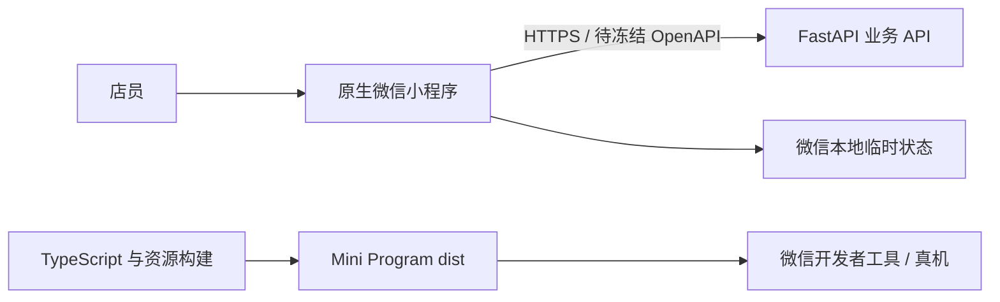

# 数得快原生微信小程序前端架构

## 1. 范围与目标

本前端是 `medium` 档位的 `wechat-mini-program`，只交付原生微信小程序源码、静态资源、构建产物和前端工程治理。业务 API、数据库、推理 worker 与平台后台不属于本应用；系统全景与业务契约见 `docs/03-架构与技术方案.md`，实例事实见 `architecture-profile.yaml`。

当前建设范围只有可编译的应用壳和首页。拍摄、识别、复核、汇总、历史、门店设置、微信身份与支付均不在本次实现范围，出现真实用例时再增加对应模块。



## 2. 目录与职责

```text
apps/miniapp/
├── project.config.json       # 微信开发者工具共享配置，指向 dist
└── src/
    ├── app.ts/json/wxss      # 平台入口、页面注册与全局主题
    ├── pages/                # 页面适配器；只处理视图与交互
    ├── modules/<module>/     # 出现真实业务能力后按模块创建
    │   ├── application/      # 用例、状态转换、稳定 Port
    │   ├── infrastructure/   # HTTP、存储和微信能力 Adapter
    │   └── presentation/     # 可复用展示状态与交互模型
    ├── shared/               # 至少两个真实消费者使用的跨模块能力
    ├── generated/            # OpenAPI 生成代码，禁止手改
    └── styles/               # 全局主题入口与语义 Token
```

初始工程不创建空 `modules/`、`shared/` 或 `generated/`。页面以 `app.json` 为唯一注册源；页面目录与路由保持一一对应。

## 3. 依赖方向

固定方向为 `pages / presentation → application ← infrastructure`。`app` 只做平台启动和组合；`shared` 不反向依赖 App、页面或业务模块。跨模块调用只能通过模块明确导出的稳定契约，不使用全局 service locator、事件总线或可变 registry 隐藏依赖。

页面和 Presentation 禁止直接调用 `wx.request`。远程数据经 `shared/http` 的唯一客户端进入 Infrastructure，再映射为 Application 契约。页面参数、API 响应、微信回调和持久化数据先以 `unknown` 接收并校验。

## 4. 状态、生命周期与样式

- Page/Component data 只保存渲染所需的小型可序列化状态；业务状态转换使用纯函数或 Application 命令。
- `setData` 只提交发生变化的最小字段，不传图片二进制、大数组副本或可由现有状态推导的数据。
- `onLoad/onShow` 创建的请求、计时器、监听与订阅必须在对应隐藏或卸载路径取消或释放；迟到结果必须通过请求标识或版本判断阻止覆盖。
- 持久化键由唯一 owner 定义并带 Schema 版本；草稿、本地临时数据与服务端事实不得混用。
- `styles/tokens.wxss` 定义语义颜色、排版、间距、圆角与阴影；`styles/theme.wxss` 负责全局基础样式。页面样式就近维护，不复制设计 Token。

## 5. 契约与安全

后端 OpenAPI 未冻结前不生成客户端、不手写另一套完整 DTO。契约到位后，生成代码进入 `src/generated/`，由漂移检查保证可重复生成；Infrastructure 负责 Transport DTO 与 Application 类型映射。

AppSecret、token、私有图片地址和门店敏感标识不得进入源码、构建参数、普通日志或版本化项目配置。`project.private.config.json` 仅用于开发者本机并被忽略。客户端只做体验控制，门店、角色、金额、完成状态和用量权限必须由服务端重新校验。

## 6. 构建与验收

源码位于 `apps/miniapp/src/`，构建只可清理 `apps/miniapp/dist/`。TypeScript 编译为微信可执行的 CommonJS，WXML、WXSS、JSON 和显式支持的静态资源保持相对路径复制。构建后检查入口、页面四件套、禁止文件、引用完整性和 Profile 定义的 2 MiB 主包预算。

合并前执行 `pnpm verify`，覆盖 Profile、工具链、格式、类型、Lint、架构边界、依赖环、自动化测试、覆盖率、生产构建、依赖审计、许可证与 Secret。自动化检查不能代替 `docs/06-测试与验收计划.md` 的微信开发者工具与真机矩阵。
